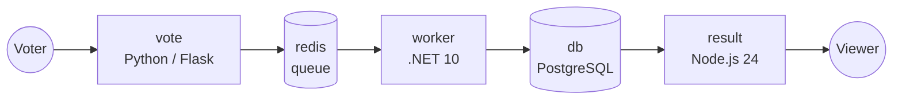
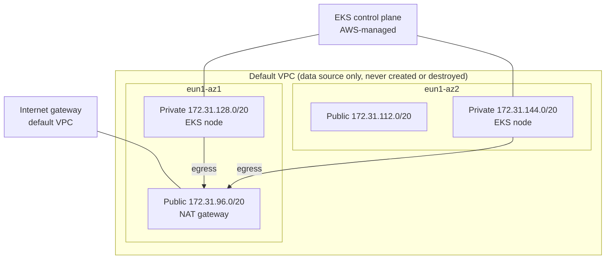
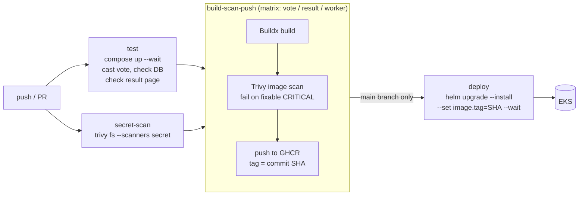

# Capstone 1: Example Voting App on Amazon EKS

**From `docker compose up` to a hardened, Terraform-built EKS cluster with CI/CD, Helm releases and one-command rollback**

This repository is a fork of [dockersamples/example-voting-app](https://github.com/dockersamples/example-voting-app). The five-service voting app is taken from a local Docker Compose demo all the way to production-style delivery on AWS: hardened images, infrastructure as code, a CI pipeline with secret and vulnerability scanning, and Helm-based deploys that can be rolled back.

| Phase | Goal | Status |
|---|---|---|
| 1 | Run locally: the whole app works with Docker Compose | ✅ Done |
| 2 | Containerize safely: pinned images, non-root, no CRITICAL CVEs | ✅ Done |
| 3 | Infrastructure as code: EKS on AWS with Terraform | ✅ Done |
| 4 | CI/CD with GitHub Actions: test, scan, build, push, deploy | ✅ Done |
| 5 | Helm deploy and rollback | ✅ Done |
| Stretch | Remote Terraform state with locking | ✅ Done |
| Extra | EBS CSI driver (persistent volumes, used by Capstone 2) | ✅ Done |

The same cluster later hosts **Capstone 2** ([AKPOCHI/robot-shop](https://github.com/AKPOCHI/robot-shop)): Stan's Robot Shop with Prometheus, Loki, Jaeger and SLO alerting.

---

## Contents

1. [The application](#1-the-application)
2. [Phase 1: Run locally](#2-phase-1-run-locally)
3. [Phase 2: Containerize safely](#3-phase-2-containerize-safely)
4. [Phase 3: EKS with Terraform](#4-phase-3-eks-with-terraform)
5. [Phase 4: CI/CD with GitHub Actions](#5-phase-4-cicd-with-github-actions)
6. [Phase 5: Helm deploy and rollback](#6-phase-5-helm-deploy-and-rollback)
7. [Remote state and the bootstrap stack](#7-remote-state-and-the-bootstrap-stack)
8. [Repository layout](#8-repository-layout)
9. [Rebuild from scratch](#9-rebuild-from-scratch)
10. [Cleanup](#10-cleanup)
11. [Problems solved](#11-problems-solved)
12. [Trade-offs and known limitations](#12-trade-offs-and-known-limitations)

---

## 1. The application



A vote goes into a Redis queue. The worker takes it off the queue and writes it to Postgres, and the result page shows live totals. The service names `redis` and `db` are hard-coded in the application, so they stay fixed everywhere: in Compose, in the Helm chart, and in Kubernetes.

---

## 2. Phase 1: Run locally

```bash
docker compose up
```

- Vote at http://localhost:8080 and see results at http://localhost:8081.
- All five services come up healthy, and votes flow vote → Redis → worker → Postgres → result.

The Compose file is also the CI smoke test (see [Phase 4](#5-phase-4-cicd-with-github-actions)).

---

## 3. Phase 2: Containerize safely

| Practice | Implementation |
|---|---|
| **Reproducible base images** | Every `FROM` is pinned by digest (`image:tag@sha256:...`), including Redis and Postgres in Compose |
| **Non-root containers** | vote and worker run as UID 10001, result as UID 1000 |
| **Small build contexts** | A `.dockerignore` in each service |
| **No CRITICAL CVEs** | Upgraded result to **Node 24** and worker to **.NET 10**, ran `apt-get upgrade` in result's image, and ran `npm audit fix` (cleared 14 npm CVEs). **15 CRITICAL CVEs fixed in total** |

Pinned data-store images:

| Image | Digest |
|---|---|
| Redis | `sha256:3811787313eba226a2ef38658c6ccb91cd5e110edc89c37767de373120a0e5a0` |
| Postgres | `sha256:f7d23353e1b15400d22ebe31189f4d314b87a4c129cc400c8c2d8d4ca127bf81` |

**Build time:** the first build took **2 h 10 min** on a slow connection. After pinning digests that were already cached, a rebuild takes **24 seconds**.

---

## 4. Phase 3: EKS with Terraform

### Network design



| Decision | Reason |
|---|---|
| **Region `eu-north-1`** | The AWS account's Service Control Policy allows only this region |
| **Default VPC as a data source** | Avoids changing account-level networking. Terraform adds its own subnets, but never creates or deletes the VPC |
| **4 subnets across 2 Availability Zones** | Public subnets for the NAT gateway and load balancers; private subnets for the nodes |
| **AZ IDs (`eun1-az1`, `eun1-az2`), not names** | AZ *names* map to different physical zones in different accounts. IDs don't |
| **One NAT gateway** | Nodes have **private IPs only** and get outbound access through NAT. One gateway instead of two halves the cost, at the price of AZ redundancy |
| **Network ACL per subnet** | Private subnets only accept traffic from inside the VPC, plus return traffic |
| **`upgrade_policy { support_type = "STANDARD" }`** | Avoids EKS extended-support pricing |
| **2 × `m7i-flex.large` nodes** | The account's Free plan rejected `t3.medium` (the node group sat in `CREATING`). `m7i-flex.large` is Free-tier eligible |

### Terraform files (`terraform/`)

| File | Contents |
|---|---|
| `versions.tf` | Terraform and AWS provider versions, S3 backend |
| `variables.tf` | Region, cluster name, AZ IDs, instance type |
| `network.tf` | Subnets, route tables, NAT gateway and Elastic IP, NACLs |
| `main.tf` | EKS cluster, managed node group, IAM roles |
| `access.tf` | EKS access entry for the CI deploy user |
| `storage.tf` | EBS CSI driver through **EKS Pod Identity** |
| `outputs.tf` | Cluster name and endpoint, subnet IDs, NAT IP, kubeconfig command |

### EBS CSI driver (`storage.tf`)

The cluster needs persistent volumes for Capstone 2 (Redis and Loki). The driver normally gets its AWS permissions through an IAM OIDC provider, **but the account's SCP blocks creating OIDC providers**. So it uses **EKS Pod Identity** instead: the `eks-pod-identity-agent` add-on, plus an IAM role (`voting-app-ebs-csi`, with `AmazonEBSCSIDriverPolicy`) associated with the service account `kube-system/ebs-csi-controller-sa`. That adds 5 resources to the stack.

### Verified

- `terraform plan` on a clean account: **33 to add** (28 for the cluster and network, 5 for the EBS CSI driver).
- Full **destroy and rebuild from code**, with both nodes coming back `Ready` on private IPs only, and egress through the NAT gateway.
- `terraform destroy`: **33 destroyed**. The default VPC is untouched.

---

## 5. Phase 4: CI/CD with GitHub Actions

`.github/workflows/ci.yaml`



| Job | What it proves |
|---|---|
| **test** | `docker compose up --wait`, casts a real vote, polls Postgres until it's counted, checks the result page, then `docker compose down -v`. An end-to-end smoke test on every push |
| **secret-scan** | `trivy fs --scanners secret .` **fails the pipeline** if any secret is committed |
| **build-scan-push** | Builds each image, scans it with Trivy (any **fixable CRITICAL** fails the build), then pushes `ghcr.io/akpochi/voting-app-<service>:<commit SHA>` |
| **deploy** (`main` only) | Checks the cluster exists, creates the DB Secret from `DB_PASSWORD`, then `helm upgrade --install --set image.tag=$SHA --wait` |

- **Images:** `ghcr.io/akpochi/voting-app-vote`, `voting-app-result` and `voting-app-worker` (public GHCR packages).
- **Supply-chain hygiene:** the Trivy action is pinned to a commit SHA, `aquasecurity/trivy-action@ed142fd0673e97e23eac54620cfb913e5ce36c25 # v0.36.0`.
- **Immutable tags:** every image is tagged with the commit SHA, so a deploy always points at exactly one build.

**GitHub secrets required:** `AWS_ACCESS_KEY_ID`, `AWS_SECRET_ACCESS_KEY`, `DB_PASSWORD`.

### Why access keys, not OIDC

The preferred way for GitHub Actions to authenticate to AWS is **OIDC federation**, which uses short-lived credentials and no stored keys. The account's SCP (`p-qfyn6wxh`) **blocks creating IAM OIDC providers**, so that wasn't possible. Instead, the deploy uses a dedicated IAM user, `voting-app-github-deploy`, whose only AWS permission is **`eks:DescribeCluster`** (enough to build a kubeconfig). Its Kubernetes rights come from an **EKS access entry** in `access.tf`, not from IAM. See [Trade-offs](#12-trade-offs-and-known-limitations).

---

## 6. Phase 5: Helm deploy and rollback

### The chart (`helm/voting-app/`)

One chart and one values file deploy all five services.

| Design choice | Why |
|---|---|
| Service names `redis` and `db` are fixed | They're hard-coded in the application |
| `db.existingSecret: db-credentials` | **The chart never creates the password Secret.** CI creates it from the `DB_PASSWORD` GitHub secret, so no password is ever in git or in the chart's values |
| `vote.replicas: 2` | Rolling updates without downtime |
| Non-root containers bind low ports through `sysctls: net.ipv4.ip_unprivileged_port_start=0` | Keeps UID 10001 / 1000 without needing root for ports below 1024 |
| `emptyDir` for Postgres | No volume driver at the time of Phase 5. (The EBS CSI driver was added later for Capstone 2.) |

The worker and result read the password from the `POSTGRES_PASSWORD` environment variable, which is populated from the Secret.

### Rollback demo

| Revision | Action | Result |
|---|---|---|
| **1** | `helm install` | 6 pods `Running`, app working |
| **2** | `helm upgrade --set image.tag=bad-release-does-not-exist` | **FAILED**: new pods in `ImagePullBackOff`. The **old pods kept serving traffic**, because the rolling update never replaced healthy pods with unhealthy ones |
| **3** | `helm rollback voting-app 1` | "Rollback was a success!" All 6 pods healthy, **votes intact** |

The evidence is three Helm release Secrets: `sh.helm.release.v1.voting-app.v1`, `.v2` and `.v3`.

```bash
helm history voting-app
helm rollback voting-app 1 --wait
```

---

## 7. Remote state and the bootstrap stack

### Remote state

Both Terraform stacks keep their state in **S3** rather than on a laptop.

| Setting | Value |
|---|---|
| Bucket | `voting-app-tfstate-038884640469` (versioning on, all public access blocked) |
| Cluster stack key | `eks/terraform.tfstate` |
| Bootstrap stack key | `bootstrap/terraform.tfstate` |
| Locking | `use_lockfile = true`, Terraform 1.10+'s **native S3 locking**, with no DynamoDB table. During `apply`, a `.tflock` object is visible next to the state file |

### Bootstrap stack (`terraform/bootstrap/`)

This is a separate, **permanent** stack holding the CI deploy user `voting-app-github-deploy` and its single `eks:DescribeCluster` permission. It's kept apart from the cluster stack so the cluster can be destroyed and rebuilt at will without rotating the GitHub secrets each time.

---

## 8. Repository layout

Only files added or changed for the capstone are listed.

```
example-voting-app/
├── README.md
├── docker-compose.yml                # digest-pinned images, healthchecks, used by CI
├── vote/   result/   worker/         # Dockerfiles: digest-pinned, non-root, .dockerignore
├── .github/workflows/ci.yaml         # test, secret-scan, build-scan-push, deploy
├── helm/voting-app/                  # Phase 5 chart
│   ├── Chart.yaml
│   ├── values.yaml
│   └── templates/
└── terraform/
    ├── versions.tf  variables.tf  network.tf  main.tf
    ├── access.tf                     # EKS access entry for the CI user
    ├── storage.tf                    # EBS CSI driver through Pod Identity
    ├── outputs.tf
    └── bootstrap/main.tf             # permanent CI IAM user (separate state)
```

---

## 9. Rebuild from scratch

Prerequisites: AWS CLI configured for account `038884640469`, Terraform 1.10+, `kubectl` and Helm.

```bash
# 1. Permanent CI user (once per account; usually already exists)
cd terraform/bootstrap
terraform init && terraform apply

# 2. Cluster, network and EBS CSI driver
cd ..
terraform init
terraform plan -out=tfplan        # expect: 33 to add
terraform apply tfplan            # about 15 minutes

# 3. Point kubectl at the cluster
aws eks update-kubeconfig --region eu-north-1 --name voting-app
kubectl get nodes                 # 2 nodes Ready, private IPs

# 4. Deploy: push any commit to main, and the deploy job runs helm upgrade --install
git commit --allow-empty -m "Redeploy" && git push origin main

# 5. Check
helm history voting-app
kubectl get pods
```

Always **create a fresh plan** (`terraform plan -out=tfplan`) before `terraform apply tfplan`. Applying an old saved plan silently skips any changes made since it was saved. That's how the EBS CSI resources were once missed (see problem 11).

---

## 10. Cleanup

```bash
# Delete anything that owns an EBS volume first (Capstone 2's PVCs), then:
cd terraform
terraform destroy                 # expect: 33 destroyed
```

The bootstrap stack and the state bucket are meant to stay. They cost nothing while the cluster is down. The cluster itself (the EKS control plane, the NAT gateway, two nodes) costs about **$0.35 an hour**, so destroy it whenever it isn't in use.

---

## 11. Problems solved

| # | Problem | Cause | Fix |
|---|---|---|---|
| 1 | First image build took 2 h 10 min | Slow connection, unpinned base images pulled fresh | Pinned already-cached digests: rebuilds now take 24 s |
| 2 | `mapping key "networks" already defined` | YAML indentation broken by hand-editing | Fixed with scripted PowerShell edits, and never hand-edited YAML again |
| 3 | Terraform `AccessDenied` in the original region | The SCP allows only `eu-north-1` | Moved the whole stack to Stockholm |
| 4 | AWS signature errors | The Windows clock was **346 s** slow | Measured against AWS's `Date` header and resynced the clock |
| 5 | Node group stuck in `CREATING` | The Free plan only allows Free-tier instance types | Switched from `t3.medium` to `m7i-flex.large` |
| 6 | Pull requests opened against `dockersamples` | GitHub defaults the base repository to the upstream for forks | Always set the base repository to the fork |
| 7 | 15 CRITICAL CVEs | Outdated runtimes and packages | Node 24, .NET 10, `apt-get upgrade`, `npm audit fix` |
| 8 | Couldn't create an IAM OIDC provider for GitHub Actions | SCP `p-qfyn6wxh` | A scoped IAM user plus an EKS access entry (documented trade-off) |
| 9 | `ci.yaml` committed as 0 bytes | The file wasn't saved in VS Code | Created files with PowerShell `Set-Content` from then on |
| 10 | `docker-compose.yml` broken again | Indentation | Restored it with `git checkout origin/main -- docker-compose.yml` |
| 11 | EBS CSI driver missing after `apply` | `terraform apply tfplan` used a plan saved **before** `storage.tf` existed | Always run a fresh `plan -out` before `apply` |
| 12 | EBS CSI driver couldn't get AWS credentials the usual way | The SCP blocks OIDC (IRSA) | EKS Pod Identity |

---

## 12. Trade-offs and known limitations

- **Long-lived access keys in GitHub secrets** instead of OIDC, which the SCP forced. They're mitigated by giving the IAM user a single AWS permission (`eks:DescribeCluster`). However, its EKS access entry grants `AmazonEKSClusterAdminPolicy` at **cluster scope**, so anyone holding the keys can administer the cluster. A tighter setup would scope the access entry to the app's namespace with `AmazonEKSEditPolicy`, and rotate the keys regularly.
- **One NAT gateway:** if `eun1-az1` fails, nodes in both zones lose outbound internet access. A production setup would use one NAT gateway per AZ.
- **Postgres on `emptyDir`:** votes are lost if the `db` pod is rescheduled. Now that the EBS CSI driver exists, the next step is a gp3 PersistentVolumeClaim (or Amazon RDS).
- **The Kubernetes version isn't pinned:** new clusters get AWS's current default (1.37 at the last rebuild). Pinning `version` in `main.tf` would make rebuilds fully reproducible.
- **Public EKS API endpoint** (`0.0.0.0/0`), needed so GitHub-hosted runners can deploy. A tighter setup would use self-hosted runners inside the VPC, with a private endpoint.

---

*Upstream project: [dockersamples/example-voting-app](https://github.com/dockersamples/example-voting-app).*
