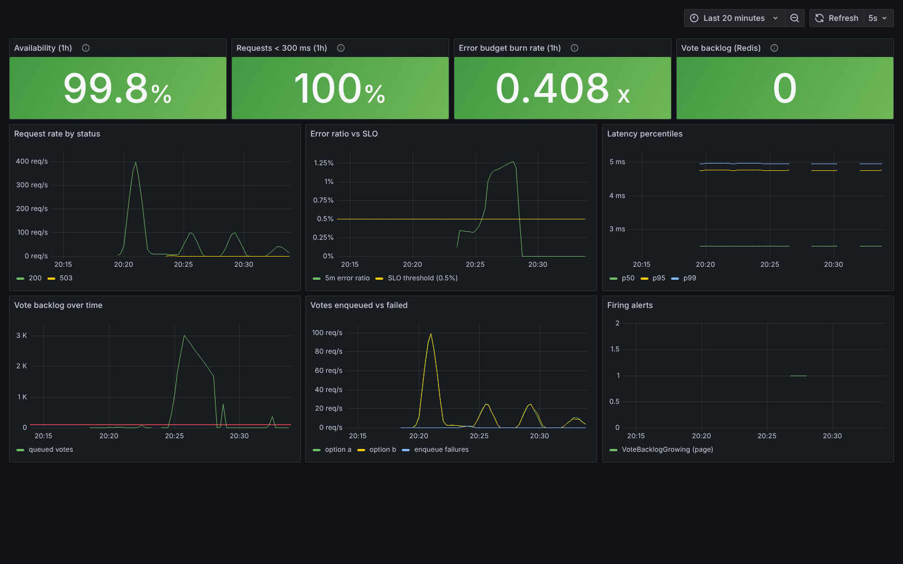
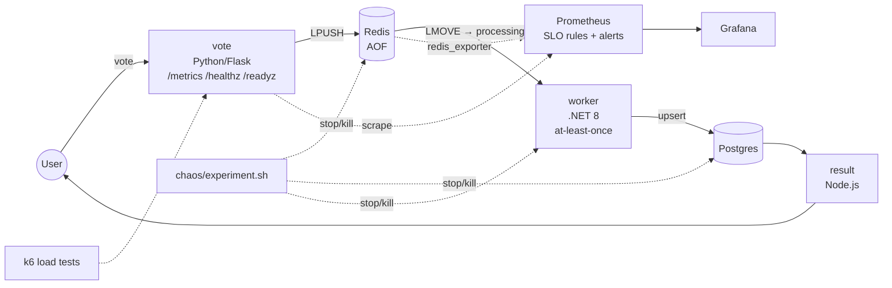

# Voting App: SRE Edition

**Every HTTP SLO was green. Meanwhile 20,176 votes were stuck in a queue, and a database blip was quietly deleting votes users had been told were saved.**

This repo takes Docker's [example voting app](https://github.com/dockersamples/example-voting-app) and runs it the way I ran production systems at Lowe's: SLOs with burn-rate alerts, load tests that gate CI, chaos experiments, runbooks, and a blameless postmortem. Then it fixes what the experiments found.



*The real dashboard during the game day: the spike at 20:20, the Postgres outage pushing the error ratio over the SLO line, the backlog building and draining, and `VoteBacklogGrowing` firing.*

---

## What the experiments found

Full write-up: **[Game Day 001: Green dashboards, lost votes](docs/gamedays/001-silent-backlog-and-lost-votes.md)**

| Experiment | Before | After the fix |
|---|---|---|
| Spike to 200 users: peak vote backlog | **20,176** (results ~50 min behind) | **24** |
| Postgres down 20 s at 50 votes/s: accepted votes lost | **3** | **0** of 3,501 |
| Redis crash (`SIGKILL`) with 137 votes queued: lost | **137** | **0** |
| HTTP availability / p99 latency during the spike | 100% / 4.2 ms | 100% / 4.2 ms |

The last row is the point. **The front-door SLOs could not see any of these failures.** They needed a freshness SLO, at-least-once delivery, and a durable queue.

| Root cause | Fix |
|---|---|
| Worker slept 100 ms after *every* vote → capped at ~10 votes/s | Sleep only when the queue is empty |
| `LPOP` then write = at-most-once; a crash between the two loses the vote | `LMOVE` to a processing list, write, *then* acknowledge; idempotent upsert makes retries safe |
| Worker crashed on a DB error, dropping the in-flight vote | Reconnect and retry instead of exiting |
| Redis had snapshots only, so a crash lost everything since the last one | AOF with `appendfsync everysec` and a persistent volume |
| No SLO covered "my vote is counted" | Freshness SLO (backlog < 100) with a paging alert |

---

## Architecture



## SLOs

| SLO | Target | Alert |
|---|---|---|
| Availability (non-5xx) | 99.5% / 28 d | Multi-window burn rate: **page** at 14.4×, ticket at 6× |
| Latency (< 300 ms) | 99% / 28 d | Burn rate: **page** at 14.4× |
| Freshness (votes queued) | < 100 | **Page** after 2 min |

Reasoning, error budget policy and alert design: **[docs/SLOs.md](docs/SLOs.md)**. The alerts have **unit tests** ([`slo_test.yml`](observability/prometheus/tests/slo_test.yml)): a sustained 10% error rate must page, and a 5-minute blip that has already recovered must not.

Runbooks: [high error rate](docs/runbooks/vote-high-error-rate.md) · [vote backlog](docs/runbooks/vote-backlog.md)

---

## Run it

Needs Docker. `make help` lists everything.

```bash
make up            # app + Prometheus + Grafana
```

| | |
|---|---|
| Vote | http://localhost:5000 |
| Results | http://localhost:5001 |
| Grafana (SLO dashboard) | http://localhost:3000 |
| Prometheus alerts | http://localhost:9090/alerts |

```bash
make load          # k6: ramp to 50 users, thresholds = SLOs
make spike         # k6: 10 -> 200 users
make chaos-db      # stop Postgres for 20 s under 50 votes/s, count lost votes
make chaos-redis   # stop Redis for 20 s, measure user-facing errors
make test          # unit tests + alert-rule tests
```

### On Kubernetes (kind)

```bash
make k8s-up        # kind cluster, build images, kubectl apply -k k8s/base
```

The manifests in [`k8s/base`](k8s/base) include: separate liveness and readiness probes (a Redis outage drops vote pods from the load balancer instead of restarting them), resource requests and limits, a PodDisruptionBudget, an HPA, zero-downtime rolling updates with a `preStop` drain, non-root containers with a restricted security context, and StatefulSets with persistent volumes for Redis and Postgres. [`k8s/monitoring`](k8s/monitoring) has ServiceMonitors, a PrometheusRule (generated from the same `slo.yml`) and the dashboard for kube-prometheus-stack.

## CI

Every push runs [`.github/workflows/ci.yml`](.github/workflows/ci.yml):

1. **Unit tests**: vote service, plus promtool tests for every alert
2. **Manifest validation**: kubeconform against the Kubernetes and CRD schemas; fails if the k8s rules drift from `slo.yml`
3. **SLO gate**: Docker Compose up, k6 smoke test (fails on SLO thresholds), then **the Postgres-outage chaos experiment. CI fails if a single vote is lost.**
4. **Kubernetes e2e**: deploy to kind, vote through the NodePort, then scale Redis to 0 and check that vote pods go NotReady **without restarting**

## Repo layout

| Path | What |
|---|---|
| `vote/` | Flask front end with Prometheus metrics, health/readiness split, 503 on Redis failure, tests |
| `worker/` | .NET 8 worker: at-least-once delivery, idempotent writes, reconnect instead of crash |
| `result/` | Node.js results page (upstream, unchanged) |
| `observability/` | Prometheus config, SLO recording and alerting rules, alert unit tests, Grafana dashboard |
| `loadtest/` | k6 scenarios: smoke, load, spike, steady |
| `chaos/` | Repeatable failure-injection experiment with a data-integrity check |
| `k8s/` | Kustomize manifests + monitoring resources |
| `docs/` | SLOs, runbooks, game day postmortem with raw results |

---

*Based on [dockersamples/example-voting-app](https://github.com/dockersamples/example-voting-app) (Apache 2.0). The upstream app code is theirs. The reliability work (instrumentation, SLOs, alerts, load and chaos testing, worker and Redis fixes, Kubernetes hardening, CI and docs) is mine.*
